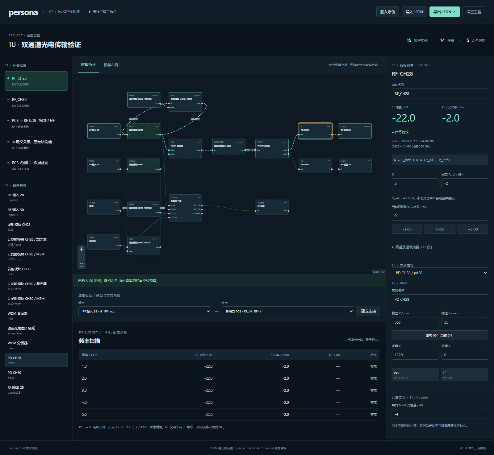
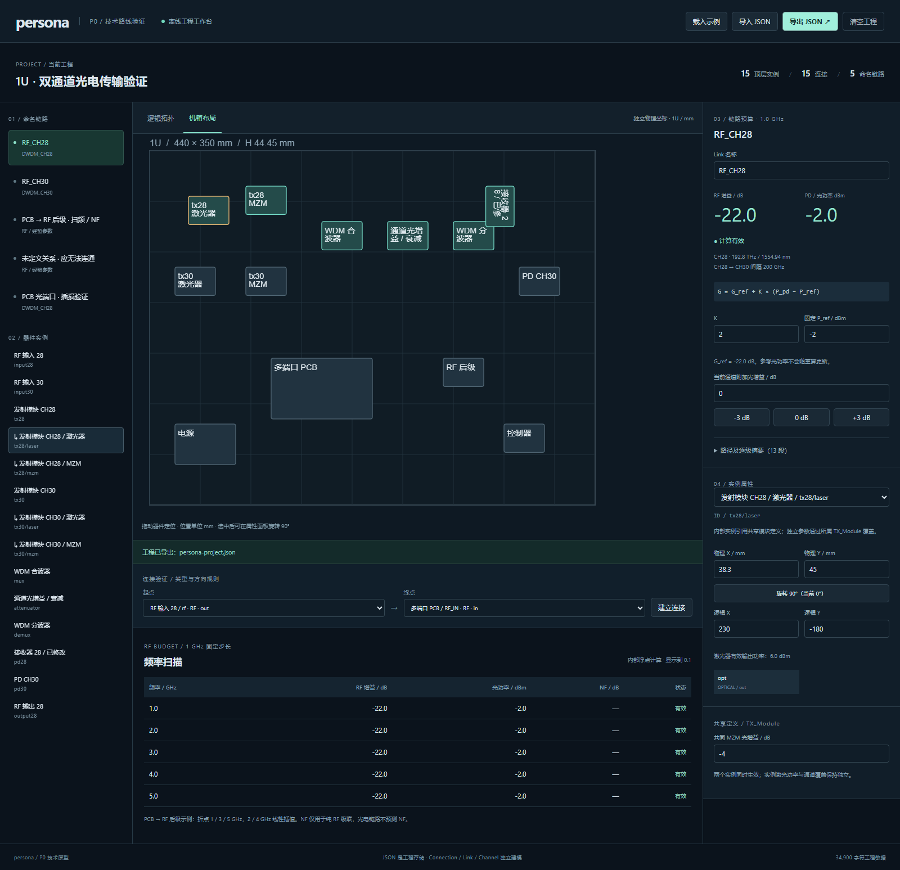

# persona P0 验证报告

验证日期：2026-11-17（Asia/Shanghai）。输入仓库：`czaozhiyuan/persona`，基线提交 `f53d26d83dfcc3ad60b7d430bfb54218ceb64d28`。实现位于本地 `E:\2026\Persona`，工作分支 `codex/p0-validation`；原任务书未改动。本报告记录本机验证结果，提交与推送状态以 Git 历史和远端分支为准。

## 结论与交付

React + TypeScript + Vite、React Flow、React Konva 和 singlefile 的技术路线已在同一薄原型中贯通。纯数据层 **8 项测试通过、0 失败、0 跳过**，类型检查与单文件构建通过；本机 Chrome、Edge 均通过 offline `file://` 自动交互验证，无 HTTP/HTTPS 请求、无页面异常和控制台 error。A2–A9 通过；A1 的自动化部分通过，真实断开系统网络后的人工双击仍待验收，故 A1 总体记为部分通过。

| 交付物 | 位置 |
|---|---|
| 源码、构建与操作说明 | [README](../README.md)、`src/`、`scripts/`、`tests/`、`package-lock.json` |
| 最终离线单 HTML | [persona-p0.html](../artifacts/persona-p0.html) |
| 同内容构建输出 | `dist/index.html` |
| 示例工程 | [p0-project.json](../examples/p0-project.json) |
| 构建信息、校验值、许可声明 | [build-info.json](../artifacts/build-info.json)、[SHA256](../artifacts/persona-p0.html.sha256)、[第三方许可](../artifacts/THIRD_PARTY_NOTICES.txt) |
| 后续架构建议 | [P1–P5 架构建议](P1-P5_架构建议.md) |

HTML 为一个文件，849086 bytes（约 829.2 KiB）；SHA256 为 `c41c03e3c165bffbf7199b261a74adc772c82da5487d62466bea0d12e1e43d66`。全部 JS/CSS 内嵌，没有 CDN、外部字体、在线 API、后端或唯一依赖浏览器缓存的存储。第三方许可文本也内嵌于 HTML 的惰性 template 中。

## 环境与复现

| 项目 | 实测版本 |
|---|---|
| 平台 | Windows x64，系统内核版本 10.0.19045 |
| Node / npm | 24.14.0 / 11.9.0 |
| React / React DOM | 19.3.1 / 19.3.1 |
| TypeScript / Vite | 5.9.3 / 7.3.8 |
| @xyflow/react | 12.12.1 |
| react-konva / Konva | 19.3.2 / 10.9.1 |
| vite-plugin-singlefile | 2.3.4 |
| @vitejs/plugin-react / tsx | 5.2.0 / 4.23.15 |
| Playwright | 1.65.1 |
| 本机 Chrome | 157.0.8103.51 |
| 本机 Edge | 157.0.4341.60 |

```powershell
cd E:\2026\Persona
npm ci --cache ./artifacts/npm-cache --registry https://registry.npmjs.org
npm run verify
npm run test:browser
```

`package-lock.json` 固定依赖。安装/构建使用 Node，HTML 运行不需要 Node。浏览器测试调用本机浏览器，以 `context.setOffline(true)` 阻断该浏览器上下文的联网能力，打开最终交付的 `file:///E:/2026/Persona/artifacts/persona-p0.html`。整个验证过程没有启动开发服务器，也没有关闭整机网卡。脚本核对 `dist/` 只有 `index.html`，交付 HTML 与构建输出内容相同，并监测 HTTP 请求及页面/控制台错误。

证据：[引擎日志](../artifacts/engine-results.txt)、[构建日志](../artifacts/build-log.txt)、[浏览器日志](../artifacts/browser-log.txt)、[浏览器结果 JSON](../artifacts/browser-results.json)、[直接读取示例 JSON 的计算结果](../artifacts/calculation-results.json)。

## A1–A9 验收记录

| 编号 | 状态 | 实际检查与证据 |
|---|---|---|
| A1 | **部分通过** | Chrome/Edge headless、offline 上下文、无服务器、最终单 HTML `file://`；中文、编辑、计算、JSON 下载及文件输入通过，网络请求 0。尚未执行系统网卡断开、人工双击和原生文件选择对话框操作，见后文。 |
| A2 | 通过 | 15 顶层实例、4 个模块内部实例，共 19 个逻辑节点；物理视图呈现 13 个实体器件。两浏览器真实鼠标拖动 Konva 激光器、React Flow PD 节点，并导出数据比较；物理移动不改变拓扑坐标/连接，逻辑移动不改变物理坐标/连接；名称同步、90° 旋转通过。 |
| A3 | 通过 | PCB 有 RF_IN/RF_OUT、OPT_IN/OPT_OUT、DC_IN、CTRL_IN、未定义传输的 RF_SPARE。端口遍历自定义数据，新增 CONTROL 端口的规则测试通过。RF 输入→PCB RF_IN 成功、RF→OPT_IN 被拒绝；DC/CONTROL 连接显示。PCB RF 关系参与扫频、光关系得到 0.5 dBm 输出；RF_SPARE 明确不可达。 |
| A4 | 通过 | 两实例引用同一个 TX_Module，内部为激光器+MZM，具有对外端口映射和独立命名空间 `tx28/…`、`tx30/…`。激光功率/通道独立覆盖；修改模块内共同 MZM 参数，两实例同时更新。浏览器与纯数据层均核对，路径跨一个真实数据层级。 |
| A5 | 通过 | RF_CH28/RF_CH30 均经过顶层唯一 `shared-fiber` Connection。选中 Link 显示节点、连接和端口映射高亮；CH28 修改不影响 CH30。MUX/DEMUX 按通道约束及离散表查询。不可达与歧义由引擎明确报告；必经连接约束可消除歧义。 |
| A6 | 通过 | 参考光功率固定为 CH28 −2 dBm、CH30 0 dBm，G_ref=−22 dB、K=2。仅 CH28 附加光增益 −3/0/+3 dB 时，RF 分别 −28/−22/−16 dB；重复重算不重置参考。光路损耗只用于 P_pd，未再次从 G_ref 扣除。光电链路 NF 未预测。 |
| A7 | 通过 | 1–5 GHz，固定 1 GHz 步长；PCB 折点 (1,10)/(3,14)/(5,12)，RF 后级 +6 dB，总增益 16/18/20/19/18 dB，2/4 GHz 插值核对通过。超范围、缺参数、不支持通道均不填零；必要时保留独立有效的光功率、显示部分有效。 |
| A8 | 通过 | 两浏览器实际下载、清空所有实体、通过文件 input 重新导入；全工程 JSON 深比较相等。实例 ID、模块、覆盖、视图坐标、端口、Connection、Link 名称、通道表均保留。非法通道映射的导入被拒绝，原工程仍保留。 |
| A9 | 通过 | model/engine 不依赖任何图形对象；Node 测试、读取示例 JSON、路径与预算计算均可独立运行。图形编辑器只转换数据和回写对应 LayoutState。 |

自动化用例见 `tests/engine.test.ts` 的 8 个聚合场景与 `scripts/browser-smoke.ts` 的两浏览器交互流程，未建立大型测试体系。

## 关键数值

CH28 基准光功率：激光器 6 − MZM 4 − MUX 1 − 共享光纤 2 − DEMUX 1 = **−2 dBm**；CH30 激光功率覆盖为 8 dBm，因此基准 PD 功率为 0 dBm。两条 Link 分别保存固定 P_ref，均得到 −22 dB。

| CH28 附加光增益 | P_pd | G_rf = −22 + 2 × (P_pd − (−2)) |
|---|---|---|
| −3 dB | −5 dBm | −28 dB |
| 0 dB | −2 dBm | −22 dB |
| +3 dB | +1 dBm | −16 dB |

纯 RF 级联使用 `F_total = F1 + (F2−1)/G1`，F/G 转为线性量后计算。1 GHz 时 PCB 增益 10 dB/NF 3 dB，后级增益 6 dB/NF 4 dB，总增益 16 dB，NF 约 **3.317 dB**（界面 3.3 dB）。光电链路 NF 显示“—”，不由光功率修正式推断。

通道目录含 MM850、18 个 CWDM 标准中心和 CH1–CH73 的 100 GHz 离散映射，不将合法体系写死成两个通道。P0 示例器件的通道性能表仅填 CH28/CH30，其他通道必须明确补表，不能插值或默认为 0。

- DWDM 网格依据 [ITU-T G.694.1](https://www.itu.int/rec/T-REC-G.694.1/en)；本项目明确采用 `CHxx = 190 + xx/10 THz` 的编号约定。CH28=192.8 THz/1554.94 nm，CH30=193.0 THz/1553.33 nm，差 **200 GHz**，与 [FS 100 GHz 器件通道表第 8 页](https://resource.fs.com/mall/doc/20230602112522ge896a.pdf) 相符；不套用其他设备的 50 GHz 通道编号。
- CWDM 目录采用 [ITU-T G.694.2](https://www.itu.int/rec/T-REC-G.694.2/en) 的 1271–1611 nm、20 nm 间隔中心；界面标签可保留 1370/1390 的习惯名称，稳定 ID/中心为 CWDM_1371/1371 nm、CWDM_1391/1391 nm。

## 截图

以下截图来自实际浏览器渲染；拓扑图为默认示例，物理图为拖动、重命名及旋转后的验证状态。





Edge 截图：[拓扑](../artifacts/msedge-topology.png)、[物理布局](../artifacts/msedge-physical.png)。

## 已修复问题与未完成验收

验证初期发现 React Flow 节点不可见、连线不生成：受控节点更新时丢失库测得的尺寸。已改为保存节点状态并保留测量结果；模块映射另用不可交互的 source/target handle 连接，避免把模块输入端当作普通输出端。修复后在两浏览器检查了节点显示、映射边、共享光纤高亮和真实拖动。

初期鼠标回归在切换视图后过早获取尚未完成布局的坐标，拖动未发生；改为等待节点可见并位于 viewport，拖动标题中心，随后通过导出的独立坐标验证实际变化，没有用直接注入模型状态代替鼠标操作。

**A1 人工验收缺口**：未发生运行失败；缺少系统级断网后的人工操作证据。影响仅为人工验收结论，当前 offline 自动化证据不能替代该记录。推荐保留现有技术栈，并在进入 P1 前执行以下最小验收：

1. 将 `persona-p0.html` 单独复制到一个文件夹，停止本地开发服务，断开 Wi-Fi/网线。
2. 分别用 Windows Chrome/Edge 双击打开，确认地址为 `file://`，可切换两视图、拖动器件、旋转、重命名及计算 −22/−28/−16 dB。
3. 点击“导出 JSON”，确认系统下载目录中的文件；清空工程，点击“导入 JSON”，经原生文件选择对话框选回文件，检查布局和链路保留。
4. 记录实际浏览器版本、操作人和结果；本报告不预填这些验收事实。

若企业浏览器策略禁用本地文件下载，当前替代方案是使用允许 `file://` 下载的已安装浏览器；仍应维持单文件离线约束，不能把启动后端当作已通过的替代验收。

## P0 已知边界

- 一个模块层级；端口和 PCB 数量由 JSON 配置，未实现完整器件库/模块网络编辑 UI。模块内部实例不接受顶层越级连线，对外用模块映射端口。
- 经验转换仅支持一段完整 EO→OE；没有多段光电转换、OSNR、ASE、饱和、3D、BOM、数据库、账号、模型选择或旧工程迁移。
- 物理坐标以器件局部原点为旋转中心，不做碰撞与边界约束。拓扑拥挤时需缩放或手动调整；这是 P0 交互验证，不是正式布线界面。
- 编辑立即作用于内存，没有撤销/自动保存。JSON 是独立工程存储；清空前需自行导出。
- 测试只证明本机软件行为与所列数值，不证明真实光电设备参数、工业现场精度、所有浏览器版本或跨机人工验收。
