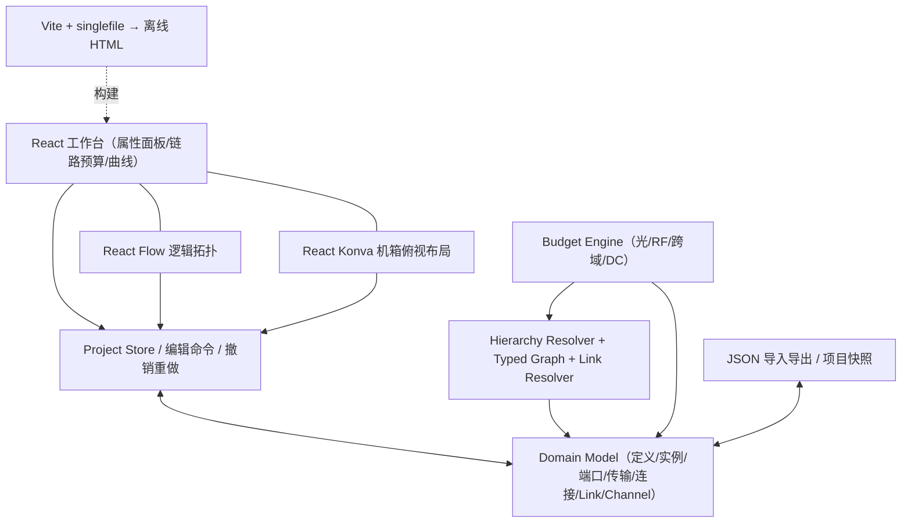

# persona V1 软件架构设计

> 状态：**V1 架构基线（PR #5 已合并）；本次接口与模块建模补充待审核**  
> 架构基线：Issue #4；当前修订：Issue #6  
> 基线：P0 已完成并合并，参见 [P0 验证报告](../P0_验证报告.md)  
> 目的：明确长期稳定的领域模型、计算与编辑边界；不是开发任务书，不构成后续 Issue 的自动实施授权。

## 1. 目标、范围与设计原则

persona 是个人离线使用的**光电设备与系统可视化设计、端到端链路预算工具**。一个 Project 可以只包含一台机箱，也可以包含多台机箱；每台机箱可独立设计，不要求当前就具备完整收发链路。支持按真实尺寸布置 2D 机箱内器件，在独立的功能拓扑中连接光、射频、电源和控制端口，定义多层可复用模块，建立完整或未完成的命名 Link，并依据器件/模块的**经验参数**计算局部及端到端的光功率、RF 增益/插损、适用范围内的 RF 级联噪声系数及供电容量。

### 1.1 已确认约束

| 维度 | V1 约定 |
|---|---|
| 平台 | React + TypeScript + Vite；React Flow 绘拓扑、React Konva 绘物理布局 |
| 交付 | 单个可通过 Windows Chrome/Edge 的 `file://` 打开的离线 HTML；项目数据用独立 JSON 导入/导出 |
| 计算 | 器件参数驱动的单频基波估算，采用正交小信号近似 |
| RF | 频率起止均在 **0–67 GHz（含端点）**；一维扫描步长固定 **1 GHz**；常量或 RF 频率折点线性插值 |
| 光 | `MM850` 固定 850 nm；`CWDM` 合法 20 nm 标准通道；`DWDM_100G` 合法 100 GHz 栅格通道；插损等按**离散通道**存值，不跨通道插值 |
| 光电跨域 | 按实际供光、RF Vπ 和加载接收结构计算 |
| PCB | 任意数量的 RF、OPTICAL、DC_POWER、CONTROL 端口；内部由显式黑盒传输关系决定可达性 |
| 层级 | 自顶向下的 ModuleDefinition/Instance 模块树；机箱是带物理包络的模块，先定义对外端口再逐步细化内部；逻辑连接与物理坐标仍独立 |
| Link | 稳定 ID、自定义名称、可选起点/终点、通道/必经约束；可跨机箱层级共享器件、光纤 |
| 连接介质 | 光纤、RF 线缆和 RJ45 网线只表示实际布线，不设置/计算长度、频响、插损等传输属性；MPO/MT 多芯光缆只增加芯序结构映射 |
| 开关及双向光模块 | 光开关是独立有状态器件；板级双向光模块由 TX 和 RX 两条独立子链路组成 |
| 电接口 | 差分、一般数字信号和普通控制线均归 CONTROL，只绘制连接，不做协议、高速或电信号仿真 |
| 额定范围 | 器件输入额定范围为可选值；已知输入越界时报告告警，缺省不判断 |
| 不做 | 账号、多用户、云服务/后端、3D、PCB 电路设计、BOM、复杂仿真、旧工程迁移、线缆参数仿真、延时/相位计算、预先构建大型扩展框架 |

原生数据内部保留浮点精度；用户结果默认显示 0.1 精度，但不暗示实际计算具有 0.1 dB 的测量准确度。

### 1.2 核心原则

1. **领域数据唯一权威源**：图形控件是领域数据的展示及编辑投影，不持有独立业务事实。
2. **定义与实例分离**：修改一个模块定义影响该定义的所有实例；实例仅覆盖明确公开的参数，不私自更改共享拓扑。
3. **物理布局与逻辑连接分离**：两张视图共用实例标识，独立保存坐标。
4. **器件传播必须有定义**：没有器件 Transfer、必要经验参数或合法通道，不得默认可达或补零；但 Connection/线缆按产品约定仅表示理想拓扑连通，**不设置且不计算介质损耗**，两者不得混淆。
5. **允许渐进式设计**：未接线端口、只有起点或终点的 Link、尚未连接的机箱都是合法状态；局部可计算指标不依赖完整收发链路。
6. **损耗只计一次**：MZM 最大透过插损与自动正交损耗各计一次。
7. **业务状态可解释**：结果区分有效、部分有效、无法计算，包含原因及所用通道、频率与路径。
8. **控制复杂度**：复用 P0 已验证的运行技术；暂不建设服务端、插件系统、通用事件总线或大型测试体系。

## 2. 系统边界与依赖方向



- `model/`：定义业务对象和单位；不导入 React/xyflow/Konva。
- `engine/`：模块展开、路径选择、计算及错误状态；输入 Project 和请求，输出结构化结果；**无副作用**。
- `state/`：集中执行增删改、选择 Link、历史撤销；同一工程一次编辑形成一个完整状态。
- `editors/topology/` 与 `editors/layout/`：领域模型到图形视图的投影与事件转换；不能把图形库内部对象写入 Project。
- `library/`：用户器件/模块定义的管理、预置示例、工程快照与显式更新。
- `storage/`：JSON 当前格式检验、导入导出、必要的文件选择；不依赖服务端。
- `report/`：逐级预算表、扫描曲线和可选 CSV 导出；计算逻辑不能放在报表代码里。

首版不要求独立 `worker`；若以后大工程确实卡顿，可再将纯计算函数搬到内联 Worker，不应为尚不存在的性能问题增加设计复杂度。

## 3. 领域数据模型：实体、标识与生命周期

### 3.1 主对象

| 对象 | 职责 | 重要约束 |
|---|---|---|
| `Project` | 工程元信息、定义快照、顶层实例、跨机箱连接、命名 Link 及各视图数据 | 一个 Project 可有一台或多台机箱；一份自包含 JSON |
| `Chassis Module` | 具有机箱物理包络信息的 ModuleDefinition 实例 | **不是与模块树并行的一种业务实体**；同样可定义子实例、对外端口、内部连接；允许空机箱、只做 TX 或 RX |
| `ComponentDefinition` | 物理/黑盒器件类型、尺寸、端口、参数与端口间行为 | 定义本身不代表放置的器件 |
| `ModuleDefinition` | 子实例、内部 Connection、对外 Port 及映射、公开参数；可选机箱物理尺寸 | 可先定义外部接口而暂不实现内部；允许引用下级模块，禁止递归定义环 |
| `Instance` | 定义引用、稳定局部 ID、名称、参数覆盖、实例级开关工作状态 | 同一父模块内 ID 唯一；同型号开关的各实例可处于不同状态 |
| `PortDefinition` | 端口 ID、类型、方向、允许通道及**可选**输入额定范围 | 不同业务端口类型不可直接连；CONTROL 可为差分、普通数字和控制线；额定范围缺省不报警 |
| `Transfer` | 一个器件内输入端到输出端的**有向关系** | 没有 Transfer 则不传递；光电器件另有供光依赖 |
| `Connection` | 同层两个端口之间的**纯拓扑**连接 | 单独 ID；可标记连接介质类别，不含线缆损耗、长度或频率响应模型 |
| `CableBundle` | 一件 MPO/MT 等多芯光缆的物理聚合对象及芯序映射 | 一件线缆，多条各自独立的纤芯连接；不设置每芯传输参数 |
| `SwitchRouting` | 光开关定义的多个状态及各状态有效的端口路由 | 路由表属于器件定义，当前状态属于 Instance；可有器件级选通插损 |
| `NamedLink` | 命名路径请求，可仅有起点、仅有终点，也可两端完整 | 开放端口和不完整 Link 是正常设计状态；已填写的端点必须有效 |
| `OpticalChannel` | 合法标准通道目录项 | 引用预置 ID，用户只能枚举选择 |
| `LayoutState` | 物理位置、逻辑节点位置、可选分组 | 坐标与拓扑逻辑互不隐式修改 |
| `CalculationResult` | 路径/逐级/汇总/扫描结果和诊断 | 是派生结果，不写入工程权威数据 |

注：器件定义、实例、端口、连接、命名链路都要有稳定的不可见 ID；显示名称允许重名、重命名，不能拿名称当关系外键。

### 3.2 结构化多层路径

P0 采用 `tx28/laser:opt` 等拼接字符串。这已足够验证原理，但多层嵌套不应继续依赖字符串拆分。

建议采用结构化端点及路径（示意 TS）：

```typescript
type InstancePath = string[]; // 例如 ["TX_A", "SLOT_01", "CBB_01", "MZM_01", "OPT_DEVICE"]
type EndpointRef = { instancePath: InstancePath; portId: string };
type ConnectionRef = { scopePath: InstancePath; connectionId: string };

type NamedLink = {
  id: string;
  name: string;
  from?: EndpointRef;                 // 未指定合法：只设计接收端时可省略
  to?: EndpointRef;                   // 未指定合法：只设计发射端时可省略
  channelId?: string;                 // 光通道约束
  via?: ConnectionRef[];              // 仅在分歧路径时需要
};
```

- `instancePath` 数组每一段都是所在作用域内的局部 ID。显示为 `TX_A / OPT_MODULE / MZM_01` 不等于存储字符串。
- 模块定义内的 Connection ID 可以重复出现在不同实例中；运行时用 `scopePath + connectionId` 唯一识别。
- **不限制固定嵌套层数**：一个 ModuleDefinition 可以包含多个下级 ModuleDefinition/ComponentDefinition，支持 4、5、6 级及更深层级；递归展开和路径引用基于数组型 InstancePath，而非字符串拼接或固定层级字段。
- 采用预先检查的**无环模块定义依赖图**；A→B→A、A→A 等递归定义必须拒绝。修改共享定义会传播到所有实例；实例参数覆盖只允许经该层定义公开的参数进行逐层映射，不允许绕过未公开的子模块接口。
- 运行时允许按实际规模设置明确的遍历/实例规模保护，以避免巨大工程耗尽资源；**这属于资源保护，不是业务上限 4/5 层**，不得静默丢弃深层节点或把合法工程当作不支持的固定深度。
- 一项物理实例在双视图中引用同一个解析后的路径；界面可生成仅供渲染的安全图形 ID，但不能反向改变领域标识。
- **端口存在但尚未接线是合法状态**，包括机箱的对外端口、模块公开端口；模块公开端口尚未映射内部端口时也允许作为待完成接口保存，但该端口无法用于贯通计算。
- **已保存的引用不可悬空**：Link 已填写的 `from`/`to`、Connection 两端以及已有模块端口映射都必须指向当前存在的端口。路径暂时不通仍合法，不等于引用失效。
- 删除共享定义端口前，检查其所有实例的关联 Connection、Link 和模块映射，展示影响并要求用户选择取消或确认解绑。确认后移除涉及的 Connection、移除失效的内部映射（可保留公开端口作为开放接口），并**清空受影响 Link 的端点字段**，保留 Link 的 ID、名称及仍合法的配置；绝不自动重绑定到其他端口。
- 两个端点都未指定的 Link 允许暂存为草稿，仍是 `incomplete`，没有可计算的端到端指标；用户可之后重新指定端点。以上对象的删除/解绑作为同一次可撤销编辑提交。

### 3.3 定义、参数与实例覆盖

- `ComponentDefinition` 包含 **参数清单（名称、单位、类型、默认值、适用范围）** 和 `Transfer`，UI 据此生成必要的参数控件；不再硬编码 `laserPowerDbm`、`opticalGainDb` 专用面板。
- `ModuleDefinition` 声明从模块公开参数到内部实例参数的映射；仅公开参数可被顶层实例覆盖。**模块可先只定义外部端口和名称，内部器件、映射及走线以后自顶向下补充**；这是合法的未完成设计，不要求提前创建虚拟的内部收发器。
- 同一工程多个实例引用一个定义。**修改定义**会更新所有未覆盖的值；**修改实例覆盖**只影响该实例。
- 器件库仅在创建时提供模板。库添加、按已有定义添加、独立复制或粘贴模块时，为每个出现的器件或模块分配独立的工程定义 ID，保留各层局部 ID、连线及映射。工程和库分别保存；之后修改模板只影响新对象。
- 选择「再次使用此模块」才会新建引用同一可编辑定义的实例。打开旧工程保留原共享关系；高级库设置只可显式更新与库模板同 ID 的旧工程快照。
- 实例化一个模块后，内部物理器件是不同的实际实例；公共器件定义仅表示相同型号，不等于物理资源相同。

### 3.4 自顶向下：机箱是带物理包络的模块

不另建与逻辑模块树并行的“机箱业务图”。同一套 `ModuleDefinition` / `Instance` 支持系统、机箱、PCB、子功能模块等不同层级；“机箱”只是**带有可选物理包络及独立 2D 画布**的模块角色。示例：

```text
系统模块 System
├─ 发射机箱实例 CHASSIS_TX → ModuleDefinition TX_CHASSIS
│  ├─ PCB_TX → ModuleDefinition TX_BOARD
│  │  ├─ Laser_TX → ComponentDefinition LASER
│  │  └─ MZM_TX   → ComponentDefinition MZM
│  └─ OPT_OUT（机箱公开光输出端口）
├─ 接收机箱实例 CHASSIS_RX → ModuleDefinition RX_CHASSIS
│  ├─ PCB_RX → ModuleDefinition RX_BOARD
│  │  └─ PD_RX → ComponentDefinition PD
│  └─ OPT_IN（机箱公开光输入端口）
└─ 系统级 Connection：CHASSIS_TX.OPT_OUT → CHASSIS_RX.OPT_IN
```

- **先接口、后实现**：可以先创建 TX_CHASSIS / RX_CHASSIS 的定义与公开端口并在 System 层接线；其内部实例、端口映射、工作参数和物理放置随后分别补充。公开端口暂未映射内部时，系统拓扑可展示已连接的机箱接口，但相关端到端计算应标记为 `incomplete`，不虚构内部通路。
- **一份定义，多份实例**：显式复用的同型号机箱模块可以实例化多次，复用逻辑接口/内部定义；各实例的物理坐标与光开关当前工作状态仍独立。
- **物理坐标不决定逻辑关系**：机箱模块实例有包络尺寸和独立相对坐标，PCB 或器件的物理摆放与其功能拓扑的逻辑分组不强制完全一致。
- **跨机箱连接来自上层模块**：在 System 层通过机箱公开端口建立 Connection 或 CableBundle，不要求跨工程文件引用；一份自包含 Project 即可逐步组合系统。

### 3.5 多级模块嵌套：不设固定最大深度

V1 必须支持类似 Verilog 的任意**有限、无环**层级实例化。下面是需要实际覆盖的**六级对象路径**；若只计可复用模块，则为 System / Chassis / 插盒 / CBB / MZM 的五级模块：

```text
L1  System（系统根模块）
├─ L2  TX_CHASSIS（发射机箱模块实例）
│  └─ L3  TX_SLOT（可插拔插盒模块实例）
│     └─ L4  TX_CBB（预设计的激光器 + MZM CBB 模块实例）
│        ├─ L5  LASER（激光器器件或功能子模块）
│        └─ L5  MZM_MODULE（MZM 子模块实例）
│           ├─ L6  MZM_OPTICAL（光学器件实例）
│           └─ L6  BIAS_PCB（偏置控制 PCB 实例）
└─ L2  RX_CHASSIS（接收机箱模块实例）
   └─ ……（独立的 RX 插盒、CBB、PD 与 RF 子模块）
```

- **同一种定义/实例机制覆盖所有层级**：System、Chassis、插盒、CBB、MZM 均为 `ModuleDefinition` 与 `Instance`；叶子可以是光器件、PCB 或其他 `ComponentDefinition`，不需要为每一层创建新实体类型。机箱只多一个可选的物理包络及其相对布局。
- **逐层公开端口**：例如 MZM 光输出从 MZM_MODULE → TX_CBB → TX_SLOT → TX_CHASSIS 逐层映射为对外 `OPT_OUT`，并在 System 层连接到 RX_CHASSIS 的 `OPT_IN`。每一层可先单独定义公开接口而不填内部实现；未映射的开放端口允许保存，但未穿通的整段 Link 不可假装计算成功。
- **跨层级 Link 展开**：系统级 Link 应能解析每一层端口映射、同层 Connection、器件 Transfer 和实例状态，回溯实际叶子端点，得到路径、逐级经验预算与高亮路径。若端口映射缺失，明确返回 `incomplete`；若起止端口已存在但连线断开，返回 `unreachable`；若存在多条有效路径，返回 `ambiguous`，不随意选择。
- **每个实例相互独立**：同一 CBB 定义复用两次，共享内部定义，但各实例独立保存公开参数覆盖、开关状态及物理位置；上层实例参数通过明确声明的映射逐级传到目标叶子参数。修改 CBB/MZM 定义会影响引用它的所有实例，而修改某个实例的覆盖值不会改变另一个实例。
- **路径与作用域**：同级实例 ID 唯一，不同层可重名；运行时端点使用完整 `InstancePath + portId`，内部 Connection 使用 `scopePath + connectionId`，所以相同 CBB 内部 ID 出现在不同机箱时不会相互冲突。删除/改名时沿用本章已有的受影响引用检查和撤销规则。
- **持久化与编辑体验**：工程 JSON 保存完整定义、实例树、逐层映射和各物理空间中的布局；导出后重导不得因嵌套层数丢失端口、Connection、Link、覆盖参数或布局。UI 可逐层进入/返回、折叠模块，但不要求一次展开整个系统所有叶子节点。

**实现边界**：P0 原型的 `resolveInstances` 和 `validateProject` 仅支持一层内部模块；这不是 V1 的功能约束。正式工程模型实现须递归解析并拒绝循环引用，不引入为了兼容 P0 结构而限制层数的代码。

## 4. 端口与信号传播

### 4.1 四类端口

- **RF**：带频率的射频信号；默认 50 Ω，允许配置标称阻抗；V1 不自动计算失配。
- **OPTICAL**：承载一个或多个离散通道的光信号；记录工作家族、通道和光功率，可关联 RF 调制来源。
- **DC_POWER**：电源方向和标称电压/容量；不与 RF 或控制信号混算。
- **CONTROL**：所有不参与模拟 RF/光学计算的普通信号连线，包括差分数字电信号、一般数字接口以及控制信号。只负责逻辑接线及端点记录，不做协议/速率、高速信号或时序仿真；不增加 DIGITAL 第五种端口。

**开放端口不构成错误。** 激光器、MZM 所在的发射机箱可以先独立保存并暴露光输出端口；另一机箱只包含 PD 和后级 RF。未接线的输出或输入端口仍然属于有效设计，不需要伪造一个对端器件。

V1 默认明确 `in` / `out` 方向。若实际双向接口需要支持，采用两条有向传输关系或显式双向端口声明（作为后续 Issue），而不是让所有输入输出自动互通。

### 4.2 端口连接与器件内部传输分开

- `Connection` 表示端口之间真实连线，必须检查 **类型、方向、通道兼容性**。连接线/光纤/同轴/RJ45 作为纯拓扑介质，不包含、也不请求用户填写长度、插损、衰减系数、频率响应、相位等属性；图中连接即理想连通，传输预算不通过 Connection 累加损耗。若需要特定经验插损，应使用有明确 Transfer/参数的器件（如衰减器、连接器功能组件）。
- `Transfer` 表示器件内部有效传播路径。PCB 可独立声明 `RF_IN_1 → RF_OUT_1` 与 `OPT_IN → OPT_OUT`；未声明的端口之间不连通。
- MZM 示例有两个输入（RF 信号、激光器供光）和一个光输出。其信号传播依赖供光有效；不能把 MZM 简化成无需供光的纯 RF→光一条增益边。
- 分路器应有各支路独立经验增益/插损，禁止无损复制光功率；MUX/DEMUX 显式声明“通道 → 端口”映射；波长转换器显式声明输入、输出通道对；光开关的有效端口关系取决于实例当前的选通状态，未选通路径不可达。
- 对 **RF 信号路径**，连接必须形成清晰的有向通路；对 **光信号**，同一根物理光纤连接可同时承载多条互不混淆的通道状态。

### 4.3 光信号状态与 WDM

每条光连接可以携带一个 `Map<ChannelId, OpticalState>` 概念上的信号集合；所有光学插损按当前通道逐项查表，不能将不同波长先相加为一个 dBm 数字后再传播。

- `MM850`：唯一 850 nm 通道。
- `CWDM`：G.694.2 中心波长 1271、1291、…、1611 nm 共 18 项；UI 可显示 1270、1290、…、1610 的常用工程标签。存储以标准中心和稳定通道 ID 为准。
- `DWDM_100G`：保持 P0 中明确的编号约定，`CHxx = (190 + xx/10) THz`，例如 CH28 = 192.8 THz，CH30 = 193.0 THz，相差 **200 GHz**。标准栅格为 100 GHz，但并不意味着任何选中的两通道相邻。
- 器件的可选通道为合法目录的**子集**；传输参数表只保存实际支持的离散通道值，不进行跨通道插值或默认外推。
- MM 与单模、CWDM 与 DWDM 不自动互连/转换；需要显式定义合法适配器或波长转换器。
- 不计算光学干涉、相位、偏振、相干合成或同频拍频噪声；同波长多光源无明确定义合并规则时提示冲突。WDM 不同通道可以共享光纤但独立计算。

### 4.4 多芯光缆与 RJ45 介质分类

- **物理线缆与逻辑纤芯不同**：`CableBundle` 表示一根 MPO/MT 多芯光缆；含一份独立、可编辑的 A 端芯号 → B 端芯号映射，例如 12 芯 MPO 可定义 `A:1 → B:12`、`A:2 → B:11`。一个 CableBundle 可以在图形上折叠呈现，但解析器会得到各纤芯独立的光连接。
- **纤芯与 WDM 通道不是一回事**：每一纤芯可以承载多条合法 WDM 波长（各自独立计算），但不同纤芯的状态不能混合；芯序交叉不代表波长转换。多芯线缆本身没有光功率衰减、长度、弯曲半径、串扰等计算参数。
- 单根光纤、同轴线和 RJ45 网线都可以作为 `Connection.mediaKind` 的纯显示/拓扑类别；**RJ45_CABLE** 只帮助表明物理网线连接，不引入 Ethernet/LVDS 等新信号域，也不计算网络吞吐量、线损或延时。
- 端点（包括机箱公开端口或光连接器）必须存在才可引用；未接线的纤芯或开放线缆端属于正常未完成设计。对于已定义的芯序映射，芯号须落在该线缆实际芯数范围且不可无意重复占用；连接操作不自动计算端口匹配之外的物理线缆性能。

### 4.5 光开关：器件定义的路由表 + 实例当前状态

- 光开关是**独立功能器件**，而不是连线或普通分路器；器件定义含全部光端口及按开关状态划分的**有效端口对**，还可以含器件级各选通路径的经验插损（固定值或通道表）。
- 每个开关实例保存当前 `switchStateId`，同型号的两个实例可以分别选择不同状态。比如 `1×8` 仅导通被选中的输出；`2×2` 可定义直通/交叉状态。
- 计算路径/Link 时按**该实例当前状态**激活相应 Transfer；未选中端口之间不可达。改变状态需要重新解析受影响的 Link，给出明确的路由与指标变化；没有自动求解或控制协议仿真。
- 分路器同时向多个输出分功率，光开关只允许其状态定义的路径导通；二者不可混作同一“无条件多出口”的 Transfer。器件级插损可以参与计算，但**连接光纤/MPO/RJ45 不提供额外插损模型**。

### 4.6 双向/异波长板级收发

- 一个含双向收发功能的 PCB/光模块，在逻辑上组合**一条 TX 子路径和一条 RX 子路径**，分别定义各自端口、光通道和经验参数；共享同一个 PCB 模块实例但两条链路不自动混合。
- 例如“850 收、CH30 发”的板级模块，可由 `RX_850` 与 `TX_CH30` 子模块组成，并公开接收/发射接口。**不将其解释成 850 nm → CH30 的波长转换器**；除非显式建模真实的波长转换功能。
- 需要时可组合光分路/合波器让两条方向的光路共用实际端口，但不强制引入一套独立的“双向光模块计算引擎”。

## 5. NamedLink：命名端到端预算对象

`NamedLink` 不是一条可视化边。它记录**可选起点、可选终点、通道以及消除歧义的必经连接**；允许仅指定一端，也允许尚未指定两端的草稿。解析引擎基于当前定义与实例快照查找可用传播路径。**端口开放、Link 未完成、端点存在但路径不可达、端点引用不存在**是不同情况。

建议使用如下约束：

1. 用户可先创建带名称的 Link 并只指定发射端 `from`、只指定接收端 `to`，或之后补齐两端；也可不创建 Link，仅保留未接线的物理/逻辑端口。
2. 缺少一端或两端 → `incomplete`（正常设计状态）；两端均存在但无路径 → `unreachable`；恰有一条路径 → `resolved`；多条可达 → `ambiguous`，提示指定波长或必经连接。`invalid_reference` 表示已填写端点丢失，是应在删除/导入阶段阻止或处理的数据错误，**不属于合法可保存的 Link 状态**。
3. 解析模块端口映射时展开到真实叶子器件，保留“顶层模块 → 内部实例”的可回溯层级；高亮时将所经端点和连接投影到当前视图。
4. 完整 Link 表示一条**已选定的端到端路径**；不完整 Link 仅表示设计意图，不产生整段预算。分光一对多时建立多条 Link，可共享器件或 Connection；没有明确的路由就不为用户自动生成所有可能路径。
5. Link 名称与 ID 独立，改名不导致别的对象失联；修改物理坐标不改变路径结果。
6. 引擎识别环路并报告“不支持反馈链路计算”；不得无限遍历。P0 深度优先路径枚举与固定访问次数上限只作原型方案，正式版优先采用可限制状态数/及时判定多路径的确定性算法，而不是暴力遍历全图所有路径。
7. Link 只引用通道目录与定义快照，不缓存一份与当前工程冲突的“权威”计算数值；需要时重新计算，界面可缓存派生结果但必须在参数变更后失效。
8. **局部计算与 Link 解析独立**：在只有激光器和 MZM 的机箱中，可以计算激光器、MZM 输出及机箱光输出端口的光功率和已知局部光插损；只有 PD 的接收机箱可计算拥有足够输入条件的本地 RF 指标。局部计算以明确的器件端口、信号源和指定边界为查询目标，不臆造尚未连接的对端或默认选择分支；缺少输入条件的指标标为不可用。只有具备完整 EO→OE 段与所需输入时才输出完整跨域 RF 增益。

## 6. 器件参数与计算引擎

### 6.1 只有一种参数表达体系

固定值、频率曲线和通道表使用同一组数值类型。

```typescript
type EmpiricalValue =
  | { kind: "fixed"; value: number }
  | { kind: "rfCurve"; points: Array<[frequencyGHz: number, value: number]> }
  | { kind: "channelTable"; values: Record<string, number> };
```

- RF 曲线点频率严格递增，折点间线性插值；超出点集范围 → 当前指标不可计算，不外推。
- 光参数按通道 ID 精确查找；无该通道条目 → 不支持/缺参数，不取最近波长值。
- 数值可选参数在定义时区分“缺失”与“数值为 0”；0 dB 传输是明确给出的有效值，不代表默认补零。
- 单位和量纲写在参数定义中：`dBm` 是功率电平，`dB` 是增益/插损，`W` 是电源功耗；界面展示可以显示正插损，但内部统一使用**带符号增益**（例如 3 dB 插损 = −3 dB 增益）。

### 6.2 计算分阶段执行

建议 API（示意，非强制最终签名）：

```typescript
resolveProject(project): ResolvedGraph
resolveLink(resolvedGraph, link): PathResult
calculateOpticalPower(resolvedGraph, path, channelId): OpticalBudget
calculateRfBudget(resolvedGraph, path, frequencyGHz, context): RfBudget
calculatePowerBudget(resolvedGraph): PowerBudget
scanRf(project, link, {startGHz, stopGHz, stepGHz: 1}): ScanResult
```

先解析层级和类型化图，再选择具体路径；独立计算所需光功率（含激光器供光支路）；最后计算 RF 输出、NF 等。另提供从指定器件或机箱边界端口计算**局部可达路径与指标**的查询入口，不强制存在完整 NamedLink。光学状态应当可追踪到通道和端口，必要时可在逐级表中展开。

### 6.3 正交小信号幅度估算

在选定通道沿实际光路、层级映射和开关状态寻找给 MZM 供光的激光器。在存在多个可达光源时指定来源。试算功率优先于源端口的有效参数，清除覆盖恢复器件值。

MZM 输入功率取实际送入 50 Ω 的 RF 功率（W）。平均输出光功率等于输入光功率乘以最大透过插损系数，再除以 2。调制深度 `m = π √(2 × 50 × P_RF) / Vπ(f)`。Vπ 曲线按伏特线性插值。普通线性光增益或损耗保持调制深度。

无源 PD 的加载转换增益 `C = ρ R_eff 10^(H_PD/20)`，直接驱动外部 50 Ω 时 R_eff 为 50 Ω，另有内部并联终端时为 25 Ω。有源接收机直接使用已加载 C(f)，单位 V/W。以 W 表示平均信号光功率 P_PD，外部负载峰值电压为 `P_PD × m × |C|`。平均光电流为 `ρ × P_PD`。

段增益为 `20 log10(π P_PD |C| / Vπ)` dB，各段与段外射频级独立累计。可在缺激励时计算相对增益。m > 0.3 标明线性外推；跨域 NF 未建模。曲线超出覆盖范围时保留已有的逐级结果。

### 6.4 RF 噪声、光功率和供电预算

- 纯 RF 级联 NF 使用线性噪声因子/增益形式的 Friis 公式：`F_total = F1 + (F2−1)/G1 + ...`。每一级必须有明确增益/NF 或符合定义的被动损耗假设；缺少参数时输出 NF 不可用。不能直接相加各级 dB NF。
- 跨域 NF 未建模，纯 RF 路径沿用 Friis 预算。
- 光功率沿光源、器件 Transfer 和连接路径逐级传播，**仅累加器件显式定义的带符号光增益**；Connection/光纤贡献的线缆损耗按产品约定为 0、不读取/存储独立损耗参数。若共用某根纤芯的多种 WDM 通道，则各通道分别计算；不同纤芯之间不隐式串扰。
- 电源预算单独建有向 DC_POWER 网络：源/转换器/负载的电压、额定输出与功率消耗，DC/DC 可配置效率；对共同负载**按物理实例只计一次**，不能按 Link 数量重复统计。P0 的电源端口建模保留，正式功耗树按独立 Issue 实现。
- CONTROL 在 V1 只检查连接和展示，涵盖普通数字、差分及控制信号；不模拟协议或电气波形，也不自动将 CONTROL 连线更改为光开关的当前状态。光开关状态是单独的实例属性，用户显式设置。

### 6.4.1 可选额定输入范围与提示

- 器件/端口可以声明输入额定范围，例如光输入功率允许区间、RF 输入功率上限或 DC 输入电压范围；单位与该输入信号一致。可以只填上限、只填下限、两者都填，也可以**完全缺省**。
- **只有当输入量可计算且该端口声明了对应限值时**，才比较输入并给出明确越界告警、器件名称和超限量；输入未知时报告“无法判定”而非推断安全，缺省限值不产生告警。
- 告警和计算是否有效分离：超出额定范围不会自动使用限幅/饱和、增益压缩或损坏模型，也不应默默把输出裁剪为最大额定值；必要时标记“经验结果超出适用范围”，交由用户判断。
- 该能力不是复杂可靠性系统，也不扩展为线缆额定值/线缆传播属性。

### 6.5 扫描与计算状态

- V1 UI 允许设置 `startGHz` / `stopGHz`，均为 **0 至 67 的整数**（含端点），`startGHz <= stopGHz`，**1 GHz** 步长，最多 68 点；选中 Link 不变，只变化频率。
- 0 GHz 为扫描边界，不意味着所有 RF 器件在 DC 有有效响应；若其经验曲线不覆盖 0 GHz，该点按“超出参数范围”处理。
- 光通道不是连续扫描坐标；选择 MM850/CWDM/DWDM 通道后，查询精确通道表。
- 显示频率、逐级与端到端 RF 增益、光功率、可能有效的 NF 及诊断。数值计算中途保留精度，显示四舍五入到一位小数。
- `valid`：请求指标全部具有所需参数且路径唯一；`partial`：例如光功率有效、RF NF 不可用；`error`：路径断开、端口不兼容、无可用通道或必需量缺失且无有效结果。
- 每个指标最好独立携带 `value/availability/reason`，避免“某一个 NF 未建模”误将全部 RF/光输出判成错误；UI 总状态从指标组合得到。

## 7. 物理布局与逻辑拓扑

### 7.1 物理视图

- **Project 是系统设计，Chassis 是一种 Module 实例**：Project 的根模块可包含多个机箱模块（甚至其他层级）；机箱模块在同一 ModuleDefinition/Instance 体系中定义子器件、对外端口、参数与内部连接，额外有可选物理包络尺寸。**不另外维护一份与模块树割裂的 Chassis 清单和业务 ID**。同一个机箱定义可复用实例化多次；各机箱实例有自己的物理布局。
- 带机箱角色的 ModuleDefinition 以 mm 定义包络宽、深、高，V1 主要绘制**俯视 2D**；器件尺寸采用占地宽×深，高度可存元数据但不做 3D。一般 ModuleDefinition 不强制具备机箱物理包络。
- 每个已放置的叶子物理器件按其**解析后的实例路径**保存物理位置，并可关联一个**机箱模块实例路径**（而不是独立 `chassisId`）。每个机箱实例的坐标空间独立；允许暂未装配/暂未摆放的实例。旋转为 90° 整数倍，原点约定在 P1 固定。
- 可提供网格、吸附、缩放、越界提醒和简单物理分组；不强制与逻辑 ModuleDefinition 层级一致。不做机械公差/热仿真/碰撞精确求解。
- 逻辑模块可以用于组织拓扑，但不可假定每个模块都拥有连续物理空间；机箱模块只是带包络属性的一类模块。**系统根模块 → 机箱 A/机箱 B → 电路板 → 光器件**构成同一棵结构化实例树。各级外部端口可先定义，再补充内部映射，系统层直接连机箱公开端口。逻辑拓扑与每个机箱的 2D 布局独立，不因模块层级自动生成物理坐标。V1 不要求实时引用其他工程文件或跨项目自动同步；可以显式导入定义快照进行组合。

### 7.2 拓扑视图

- React Flow 提供节点、端口、连线、缩放、平移；节点由 `ComponentDefinition / ModuleDefinition` 渲染，布局坐标单独保存。
- 多类型端口用明确的颜色/文字/标识体现，但连线合法性仍由领域规则检查，而不是图形 handle 颜色检查。
- 双视图共享实例名称、类型、当前 Link 选择；**移动逻辑节点不会改变物理位置，移动物理器件不会改变电光连接**。
- 选择命名 Link 时高亮其路径；对于折叠模块，以模块边界展示可用端口并支持进入模块内部查看路径。
- UI 属性编辑器由定义的参数元数据生成，不维护器件种类越多越长的硬编码 if/else 列表。

## 8. 工程文件与器件库

### 8.1 文件及一致性规则

- 一个 Project 保存为一个自包含 JSON 文件，包含系统根模块、一个或多个可选的机箱模块实例、定义快照、实例与开关状态、连接与多芯光缆映射、开放端口、完整或未完成 Link、各机箱实例布局及必要工程参数。**独立机箱模块不要求当前包含对应的收发对端**。公共器件库是可选的工程外模板集合，不是工程运行时的强制依赖。
- 统一 ProjectStore 是所有编辑操作的唯一入口；一个用户动作原子性地修改相互关联的数据并进入撤销/重做历史。无需实现并发事务数据库。
- **明确区分“设计未完成”与“数据损坏”**：缺少 Connection、无内部映射的开放模块端口、`NamedLink.from` 或 `.to` 缺省、Link 路径不可达都合法，必须可以保存并原样重新导入；已填写的端点、Connection 两端及存在的模块映射必须引用实际有效端口。
- 导入时先解析并检查 JSON 结构、ID 唯一性、引用目标有效性、端口类型/方向、单位和通道约束；**结构损坏或已填写引用悬空属于硬错误，拒绝导入且保留当前工程**。正常未完成设计不得被严格导入校验误拒；导出时使用同一规则。
- 删除已被引用的端口时，先显示受影响的各实例关联并让用户明确确认。确认解绑后清空受影响 Link 的端点（保留其 ID/名称和其他合法设置），删除受影响的 Connection，移除失效模块映射，保留仍需开放的模块公开端口；一次事务完成且可撤销。未确认则不修改工程。
- 工程格式可保留 `schemaVersion` 便于识别，但**V1 不做旧版迁移**；不支持的结构明确拒绝并提示即可。
- 保存使用浏览器 File API 读取 JSON、下载 JSON；可以在适用浏览器中增加原位文件读写，但必须有下载回退。不得依赖 HTTP、CDN、外部字体或 IndexedDB 作为唯一保存位置。
- 因为仅供个人使用，不需要登录、后端、外部数据库或多租户权限。

### 8.2 简化 JSON 结构（示意，不是冻结的 schema）

```json
{
  "schemaVersion": 2,
  "projectId": "project-demo",
  "name": "光电系统 · TX 与 RX 机箱",
  "rootModuleDefinitionId": "system",
  "componentDefinitions": [],
  "moduleDefinitions": [
    {
      "id": "system",
      "name": "系统顶层",
      "instances": [
        { "id": "CHASSIS_A_TX", "definitionId": "tx-chassis" },
        { "id": "CHASSIS_B_RX", "definitionId": "rx-chassis" }
      ],
      "connections": []
    },
    {
      "id": "tx-chassis",
      "name": "发射机箱定义",
      "physicalEnclosure": { "widthMm": 440, "depthMm": 350, "heightMm": 44.45 },
      "ports": [{ "id": "OPT_OUT", "type": "OPTICAL", "direction": "out" }],
      "instances": [],
      "mappings": []
    },
    {
      "id": "rx-chassis",
      "name": "接收机箱定义",
      "physicalEnclosure": { "widthMm": 440, "depthMm": 350, "heightMm": 44.45 },
      "ports": [{ "id": "OPT_IN", "type": "OPTICAL", "direction": "in" }],
      "instances": [],
      "mappings": []
    }
  ],
  "cableBundles": [],
  "namedLinks": [
    {
      "id": "rf-ch28",
      "name": "RF_TX_CH28（待连接接收机箱）",
      "from": { "instancePath": ["CHASSIS_A_TX"], "portId": "OPT_OUT" },
      "channelId": "DWDM_CH28"
    }
  ],
  "layout": { "physical": [], "topology": [] }
}
```

本示例说明**根模块包含多个机箱模块实例**，机箱定义先公开端口、内部可以暂为空；单端 Link 有 `from`、没有 `to` 是合法未完成设计。这里使用的是精简字段，省略了正式 schema 必须包含的参数/布局等内容，**不是可直接加载的工程 JSON**；正式 schema 由后续工程模型 Issue 冻结。完整 EO/OE 段一旦建立，`spanId` 对应的边界必须在 schema 中声明并检查。

## 9. 与 P0 实现的对应关系

| P0 内容 | V1 架构建议 |
|---|---|
| React + Vite + singlefile | **保留**；单 HTML 已有离线验证证据 |
| React Flow、Konva 双视图 | **保留**；用领域投影而非绘图库对象持久化 |
| `model/types.ts` 概念 | **保留实体语义、允许重构字段**；换为结构化多层 Endpoint、可选 Link 起止端、机箱作为模块实例/物理包络而非并行 Chassis 模型 |
| `resolveInstances` 只支持一层 | **替换为不设固定深度的无环递归展开**，覆盖 System → Chassis → 插盒 → CBB → MZM → 叶子器件，不同实例作用域/参数覆盖互不冲突 |
| `traceLink` 的 DFS/访问上限 | **替换为有边界的路径解析策略**，支持通道和必经约束 |
| P0 跨域计算 | 使用器件参数及解析出的 EO/OE 段 |
| `scan()` 固定 [1,2,3,4,5] | **改为** 0–67 GHz 可配置起止、1 GHz 步长 |
| 特定名称硬编码属性面板 | **改为**由参数定义驱动的编辑器 |
| 工程 JSON import/export | **保留**；只拒绝真正的非法引用/结构；开放端口、单端 Link、未完成模块映射及独立机箱模块必须可以往返保存 |
| P0 生成的示例 HTML、日志 | **历史验证资料**；不要求 V1 兼容 P0 工程文件 |

## 10. 最小验证基线（未来各 Issue 按影响范围选用）

1. **实例/层级**：根 System 含 TX/RX 机箱；沿 TX_CHASSIS → TX_SLOT → TX_CBB → MZM_MODULE → MZM_OPTICAL/BIAS_PCB 完成至少**五级模块、六级对象路径**的真实递归展开。可先定义各层公开端口并在顶层接线、后补内部；逐层端口映射可追踪，跨机箱 Link 穿过全层级并正确计算；同定义的 CBB 双实例参数覆盖、实例级状态与物理位置彼此独立；A→B→A 及自引用递归定义被拒绝。不得使用固定深度判断来放行或拒绝合法树。
2. **WDM/Link**：CH28/CH30 经同一纤芯但分别计算；12 芯 MPO 的交叉芯序 A:1→B:12 等映射不混芯、也不混波长；改 CH28 器件插损不影响 CH30；连接线不产生额外损耗；缺器件参数和错通道明确报错；歧义路径需约束。
3. **跨域计算**：在其他条件固定时，光损耗增加 3 dB，RF 输出降低 6 dB。Vπ 翻倍使 RF 输出降低约 6.0206 dB。
4. **RF 扫描**：0/67 两端点可选，0–67 全部 68 点；超出 RF 曲线范围局部无效；纯 RF NF 对照 Friis 手算，不由光功率推导 NF。
5. **保存/交互**：移动物理实例不改拓扑，改模块定义/Link 名称不丢失连接；五级模块与六级对象的实例路径、所有级别端口映射、连接、参数覆盖和布局经过 JSON 导入导出往返保持一致；单 HTML 在 `file://` 离线打开并正常操作。
6. **未完成机箱/Link**：机箱 A 只含激光器与 MZM、开放 `OPT_OUT`，仅 `from` 的 Link 导出再导入仍为 `incomplete`；光输出功率可局部计算，完整 RF→光→RF 增益不可计算。机箱 B 可独立保存仅含 PD 与开放输入端口的设计。
7. **端口删除和一致性**：删除被引用的模块/器件端口时，先提示影响；确认解绑后相关 Connection 移除，Link 对应端点变为缺省并保留 ID/名称/合法配置，已失效的模块映射移除；保存→导入→重新绑定保持一致。人为篡改 JSON 使一个**已填写的**端点指向不存在端口时，必须拒绝导入且不覆盖当前工程。
8. **光开关状态**：同定义的 1×8 光开关实例分别选中不同输出，路径可达性不同；2×2 直通/交叉状态切换后重算 Link；器件选通损耗有效，线缆没有损耗属性。
9. **器件额定范围/双向板卡/CONTROL**：输入额定值缺省不报警、已知输入超过额定范围应告警但不虚构饱和输出；板卡 TX_CH30 与 RX_850 各自独立建模；差分数字线和 RJ45 仅显示为 CONTROL 连线/特殊布线类别。

原则是**少量高价值定向测试**。除非相应 Issue 影响单 HTML 构建/发布，不要求每个 PR 重跑完整离线浏览器回归；编译与正式发布时机由用户决定。

## 11. 后续开发 Issue 的拆分方向（不是任务书）

按依赖逐项创建 Issue，**不要仅因本文列出就自动实施**：

| 主题 | 推荐先后关系 |
|---|---|
| 工程模型 V1：根模块与机箱模块、**无固定深度的递归实例树/端口映射**、实例路径、可选 Link 起止端、端口/传输、CableBundle、开关路由与状态、器件物理参数、JSON schema | **优先**；是其他开发的稳定边界 |
| 编辑器领域投影：模块导航、实例属性、双视图一致性 | 在基础模型可用后 |
| 模块/Link 解析：多层级、WDM、分路与路径约束 | 在基础模型后，可与编辑器部分并行 |
| 经验预算：光功率、跨域幅度、RF 增益/NF、0–67 GHz 扫描与曲线 | 在路径模型稳定后 |
| 器件库/电源预算与单 HTML 集成体验 | 按功能分别开 Issue，避免一张巨型 PR |

这只是设计分组，不强行沿用 P0 的 P1–P5 编号。具体开发的**唯一授权和验收依据是 GitHub Issue**，每个 Issue 通过独立分支、PR、审查和 Squash Merge 交付。

## 12. 设计状态与需在正式 Issue 落地时限定的细节

目前已经确定：器件物理参数模型、离散光通道、逻辑/物理独立、单 HTML、0–67 GHz/1 GHz、个人离线使用；**开放端口与单端 Link 合法、可作局部计算，Project 可以通过根模块包含多个机箱模块，已填写引用不能悬空**。另外已确认：线缆不带计算参数；多芯光缆有芯序映射；光开关按实例状态选通；双向板级模块是独立 TX+RX 子模块；差分数字接口归 CONTROL；额定输入范围可缺省；暂不计算延时与相位。

以下属于**建议的架构选择，需随本 PR 审核冻结**：多层端点使用数组路径且不设固定嵌套深度（至少验收五级模块、六级对象路径）；器件库快照与显式更新；沿图识别 EO/OE 转换段；扫描起止采用整数 GHz；模块定义递归环拒绝；电源负载按真实物理实例唯一计数。

P1 具体 Issue 将制定完整的 TypeScript 字段、数据例子和验收标准。无需为此再维护一份“开发任务书 MD”，也不把 P0 的已生成工程格式当作向后兼容负担。

---

**参考：**[P0 验证报告](../P0_验证报告.md) · [P1–P5 原型架构建议](../P1-P5_架构建议.md) · [项目开发规则](../../CONTRIBUTING.md) · [React Flow](https://reactflow.dev/) · [Konva](https://konvajs.org/)。
