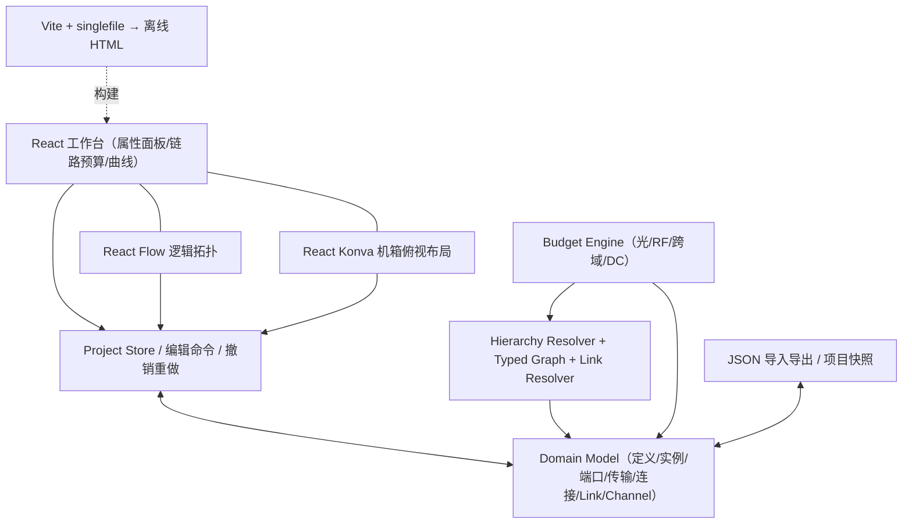

# persona V1 软件架构设计

> 状态：**设计提案 / 待审核冻结**  
> 对应 Issue：#4  
> 基线：P0 已完成并合并，参见 [P0 验证报告](../P0_验证报告.md)  
> 目的：明确长期稳定的领域模型、计算与编辑边界；不是开发任务书，不构成后续 Issue 的自动实施授权。

## 1. 目标、范围与设计原则

persona 是个人离线使用的**光电设备与系统可视化设计、端到端链路预算工具**。支持按真实尺寸布置 2D 机箱内器件，在独立的功能拓扑中连接光、射频、电源和控制端口，定义多层可复用模块，建立具有名称的端到端 Link，并依据器件/模块的**经验参数**计算光功率、RF 增益/插损、适用范围内的 RF 级联噪声系数及供电容量。

### 1.1 已确认约束

| 维度 | V1 约定 |
|---|---|
| 平台 | React + TypeScript + Vite；React Flow 绘拓扑、React Konva 绘物理布局 |
| 交付 | 单个可通过 Windows Chrome/Edge 的 `file://` 打开的离线 HTML；项目数据用独立 JSON 导入/导出 |
| 计算 | **只有统一经验参数体系**；没有物理模型/简化物理模型选项，不做电磁、时域及相干光场仿真 |
| RF | 频率起止均在 **0–67 GHz（含端点）**；一维扫描步长固定 **1 GHz**；常量或 RF 频率折点线性插值 |
| 光 | `MM850` 固定 850 nm；`CWDM` 合法 20 nm 标准通道；`DWDM_100G` 合法 100 GHz 栅格通道；插损等按**离散通道**存值，不跨通道插值 |
| 光电跨域 | 以完整 RF→光→RF 段经验标定；中间光功率变化修正端到端 RF 增益；`K` 默认 2，可编辑 |
| PCB | 任意数量的 RF、OPTICAL、DC_POWER、CONTROL 端口；内部由显式黑盒传输关系决定可达性 |
| 层级 | 模块定义、可复用实例、公开端口映射、合法参数覆盖；逻辑层级不强制映射物理摆放 |
| Link | 稳定 ID、自定义名称、起点/终点、通道/必经约束；可以跨层级且共享器件、光纤 |
| 不做 | 账号、多用户、云服务/后端、3D、PCB 电路设计、BOM、复杂仿真、旧工程迁移、预先构建大型扩展框架 |

原生数据内部保留浮点精度；用户结果默认显示 0.1 精度，但不暗示实际计算具有 0.1 dB 的测量准确度。

### 1.2 核心原则

1. **领域数据唯一权威源**：图形控件是领域数据的展示及编辑投影，不持有独立业务事实。
2. **定义与实例分离**：修改一个模块定义影响该定义的所有实例；实例仅覆盖明确公开的参数，不私自更改共享拓扑。
3. **物理布局与逻辑连接分离**：两张视图共用实例标识，独立保存坐标。
4. **传播必须有定义**：无端口传输关系、无参数、无合法通道，均不得自动按零损耗或全连通处理。
5. **一项经验量只计入一次**：跨域 RF 标定增益和光功率损耗不能被重复扣除。
6. **业务状态可解释**：结果区分有效、部分有效、无法计算，包含原因及所用通道、频率与路径。
7. **控制复杂度**：复用 P0 已验证的运行技术；暂不建设服务端、插件系统、通用事件总线或大型测试体系。

## 2. 系统边界与依赖方向



- `model/`：定义业务对象和单位；不导入 React/xyflow/Konva。
- `engine/`：模块展开、路径选择、计算及错误状态；输入 Project 和请求，输出结构化结果；**无副作用**。
- `state/`：集中执行增删改、选择 Link、历史撤销；同一工程一次编辑形成一个完整状态。
- `editors/topology/` 与 `editors/layout/`：领域模型到图形视图的投影与事件转换；不能把图形库内部对象写入 Project。
- `library/`：用户器件/模块定义的管理、预置示例、工程快照与显式更新。
- `storage/`：JSON 当前格式检验、导入导出、必要的文件选择；不依赖服务端。
- `report/`：逐级预算表、扫描曲线和可选 CSV 导出；计算逻辑不能放在报表代码里。

首版不要求独立 `worker`；若以后大工程确实卡顿，可再将纯计算函数搬到内联 Worker，不应为尚不存在的性能问题增加设计复杂度。

## 3. 领域数据模型：实体、标识与生命周期

### 3.1 主对象

| 对象 | 职责 | 重要约束 |
|---|---|---|
| `Project` | 工程元信息、当前定义快照、系统顶层实例、连接、Link、布局、可选设置 | 一份自包含 JSON；只支持当前格式 |
| `ComponentDefinition` | 物理/黑盒器件类型、尺寸、端口、参数与端口间行为 | 定义本身不代表放置的器件 |
| `ModuleDefinition` | 子实例、内部 Connection、对外 Port 及映射、公开参数 | 允许引用下级 ModuleDefinition；禁止递归环 |
| `Instance` | 定义引用、稳定局部 ID、名称、参数覆盖 | 同一模块内局部 ID 唯一，顶层局部 ID 唯一 |
| `PortDefinition` | 端口 ID、类型、方向及允许通道/额定属性 | 不同类型不可直接连；端口类型与视觉颜色无关 |
| `Transfer` | 一个器件内输入端到输出端的**有向关系** | 没有 Transfer 则不传递；光电器件另有供光依赖 |
| `Connection` | 同层两个端口之间的一段实际连接 | 单独 ID，可关联 RF 线缆/光纤及经验损耗 |
| `NamedLink` | 命名的端到端信号路径请求 | 与 Connection 不同，可与其他 Link 共用路径 |
| `OpticalChannel` | 合法标准通道目录项 | 引用预置 ID，用户只能枚举选择 |
| `ConversionProfile` | 可复用的 RF→光→RF 整段标定参数 | 明确参考条件、适用段与唯一计数口径 |
| `LayoutState` | 物理位置、逻辑节点位置、可选分组 | 坐标与拓扑逻辑互不隐式修改 |
| `CalculationResult` | 路径/逐级/汇总/扫描结果和诊断 | 是派生结果，不写入工程权威数据 |

注：器件定义、实例、端口、连接、命名链路都要有稳定的不可见 ID；显示名称允许重名、重命名，不能拿名称当关系外键。

### 3.2 结构化多层路径

P0 采用 `tx28/laser:opt` 等拼接字符串。这已足够验证原理，但多层嵌套不应继续依赖字符串拆分。

建议采用结构化端点及路径（示意 TS）：

```typescript
type InstancePath = string[]; // 例如 ["TX_A", "OPT_MODULE", "MZM_01"]
type EndpointRef = { instancePath: InstancePath; portId: string };
type ConnectionRef = { scopePath: InstancePath; connectionId: string };

type NamedLink = {
  id: string;
  name: string;
  from: EndpointRef;
  to: EndpointRef;
  channelId?: string;                 // 光通道约束
  via?: ConnectionRef[];              // 仅在分歧路径时需要
  conversionBindings?: { spanId: string; profileId: string }[];
};
```

- `instancePath` 数组每一段都是所在作用域内的局部 ID。显示为 `TX_A / OPT_MODULE / MZM_01` 不等于存储字符串。
- 模块定义内的 Connection ID 可以重复出现在不同实例中；运行时用 `scopePath + connectionId` 唯一识别。
- 采用预先检查的**无环模块定义依赖图**；模块定义的更改传播至所有实例。实例参数覆盖只允许落在定义公开的可覆盖项。
- 一项物理实例在双视图中引用同一个解析后的路径；界面可生成仅供渲染的安全图形 ID，但不能反向改变领域标识。
- 若共享定义内的某个端口被删导致 Link 失效，保留 Link 名称和配置，并以“引用失效”提示；不要悄悄换成别的路径。

### 3.3 定义、参数与实例覆盖

- `ComponentDefinition` 包含 **参数清单（名称、单位、类型、默认值、适用范围）** 和 `Transfer`，UI 据此生成必要的参数控件；不再硬编码 `laserPowerDbm`、`opticalGainDb` 专用面板。
- `ModuleDefinition` 声明从模块公开参数到内部实例参数的映射；仅公开参数可被顶层实例覆盖。
- 同一工程多个实例引用一个定义。**修改定义**会更新所有未覆盖的值；**修改实例覆盖**只影响该实例。
- 独立的公共器件库提供模板，项目保存时采用**工程内定义快照**；公共库变更不能悄悄修改已保存工程，需要用户主动“从库更新”。V1 只需要一个简单的更新动作，不引入复杂多版本同步系统。
- 实例化一个模块后，内部物理器件是不同的实际实例；公共器件定义仅表示相同型号，不等于物理资源相同。

## 4. 端口与信号传播

### 4.1 四类端口

- **RF**：带频率的射频信号；默认 50 Ω，允许配置标称阻抗；V1 不自动计算失配。
- **OPTICAL**：承载一个或多个离散通道的光信号；记录工作家族、通道和光功率，可关联 RF 调制来源。
- **DC_POWER**：电源方向和标称电压/容量；不与 RF 或控制信号混算。
- **CONTROL**：逻辑连接和命名；V1 不进行控制协议或时序仿真。

V1 默认明确 `in` / `out` 方向。若实际双向接口需要支持，采用两条有向传输关系或显式双向端口声明（作为后续 Issue），而不是让所有输入输出自动互通。

### 4.2 端口连接与器件内部传输分开

- `Connection` 表示端口之间真实连线，必须检查 **类型、方向、通道兼容性**。其参数可以描述 RF 线缆插损、光纤插损等。
- `Transfer` 表示器件内部有效传播路径。PCB 可独立声明 `RF_IN_1 → RF_OUT_1` 与 `OPT_IN → OPT_OUT`；未声明的端口之间不连通。
- MZM 示例有两个输入（RF 信号、激光器供光）和一个光输出。其信号传播依赖供光有效；不能把 MZM 简化成无需供光的纯 RF→光一条增益边。
- 分路器应有各支路独立经验增益/插损，禁止无损复制光功率；MUX/DEMUX 显式声明“通道 → 端口”映射；波长转换器显式声明输入、输出通道对。
- 对 **RF 信号路径**，连接必须形成清晰的有向通路；对 **光信号**，同一根物理光纤连接可同时承载多条互不混淆的通道状态。

### 4.3 光信号状态与 WDM

每条光连接可以携带一个 `Map<ChannelId, OpticalState>` 概念上的信号集合；所有光学插损按当前通道逐项查表，不能将不同波长先相加为一个 dBm 数字后再传播。

- `MM850`：唯一 850 nm 通道。
- `CWDM`：G.694.2 中心波长 1271、1291、…、1611 nm 共 18 项；UI 可显示 1270、1290、…、1610 的常用工程标签。存储以标准中心和稳定通道 ID 为准。
- `DWDM_100G`：保持 P0 中明确的编号约定，`CHxx = (190 + xx/10) THz`，例如 CH28 = 192.8 THz，CH30 = 193.0 THz，相差 **200 GHz**。标准栅格为 100 GHz，但并不意味着任何选中的两通道相邻。
- 器件的可选通道为合法目录的**子集**；传输参数表只保存实际支持的离散通道值，不进行跨通道插值或默认外推。
- MM 与单模、CWDM 与 DWDM 不自动互连/转换；需要显式定义合法适配器或波长转换器。
- 不计算光学干涉、相位、偏振、相干合成或同频拍频噪声；同波长多光源无明确定义合并规则时提示冲突。WDM 不同通道可以共享光纤但独立计算。

## 5. NamedLink：命名端到端预算对象

`NamedLink` 不是一条可视化边。它记录**起点、终点、可选通道以及消除歧义的必经连接**；解析引擎基于当前定义与实例快照查找可用传播路径。

建议使用如下约束：

1. 用户选择起止端口创建 Link，填写易读名称（例如 `RF_TX_CH28`）。
2. 无有效路径 → `unreachable`；恰有一条 → `resolved`；多条可达 → `ambiguous`，提示指定波长或必经连接。
3. 解析模块端口映射时展开到真实叶子器件，保留“顶层模块 → 内部实例”的可回溯层级；高亮时将所经端点和连接投影到当前视图。
4. 一条 Link 只表示一条**已选定的端到端路径**；分光一对多时建立多条 Link，可共享器件或 Connection；没有明确的路由就不为用户自动生成所有可能路径。
5. Link 名称与 ID 独立，改名不导致别的对象失联；修改物理坐标不改变路径结果。
6. 引擎识别环路并报告“不支持反馈链路计算”；不得无限遍历。P0 深度优先路径枚举与固定访问次数上限只作原型方案，正式版优先采用可限制状态数/及时判定多路径的确定性算法，而不是暴力遍历全图所有路径。
7. Link 只引用通道目录与定义快照，不缓存一份与当前工程冲突的“权威”计算数值；需要时重新计算，界面可缓存派生结果但必须在参数变更后失效。

## 6. 统一经验参数与计算引擎

### 6.1 只有一种参数表达体系

以下是同一经验计算体系中的不同**取值形态**，不是“多物理模型”：

```typescript
type EmpiricalValue =
  | { kind: "fixed"; value: number }
  | { kind: "rfCurve"; points: Array<[frequencyGHz: number, value: number]> }
  | { kind: "channelTable"; values: Record<string, number> };
```

- RF 曲线点频率严格递增，折点间线性插值；超出点集范围 → 当前指标不可计算，不外推。
- 光参数按通道 ID 精确查找；无该通道条目 → 不支持/缺参数，不取最近波长值。
- 数值可选参数在定义时区分“缺失”与“数值为 0”；0 dB 传输是明确给出的有效值，不代表默认补零。
- 单位和量纲写在参数定义中：`dBm` 是功率电平，`dB` 是增益/插损，`W` 是电源功耗；界面展示可以显示正插损，但内部统一使用**带符号增益**（例如 3 dB 插损 = −3 dB 增益）。

### 6.2 计算分阶段执行

建议 API（示意，非强制最终签名）：

```typescript
resolveProject(project): ResolvedGraph
resolveLink(resolvedGraph, link): PathResult
calculateOpticalPower(resolvedGraph, path, channelId): OpticalBudget
calculateRfBudget(resolvedGraph, path, frequencyGHz, context): RfBudget
calculatePowerBudget(resolvedGraph): PowerBudget
scanRf(project, link, {startGHz, stopGHz, stepGHz: 1}): ScanResult
```

先解析层级和类型化图，再选择具体路径；独立计算所需光功率（含激光器供光支路）；最后计算 RF 输出、NF 等。光学状态应当可追踪到通道和端口，必要时可在逐级表中展开。

### 6.3 跨域 RF 增益的唯一标定口径

将 `ConversionProfile` 建成**工程内可复用的经验标定定义**，至少包含：

- `rfGainRefDb`：整段 RF→光→RF 在基准工作点的 RF 增益（例如 −22 dB）；可为常量或 RF 频率曲线。
- `pdPowerRefDbm`：该增益对应的 **PD 接收光功率**参考值，固定不随每次重算改变。
- `k`：光功率 dB 变化对 RF 增益 dB 的经验影响系数，默认 2，可由用户覆盖。
- 标定备注：对应的 MZM、PD 组合、工作通道、参考配置及适用范围（允许简单文本，不建设复杂标定系统）。

某个 Link 通过 `ConversionBinding` 引用上述 Profile，并标明**本次标定对应的 EO 与 OE 端点/范围**。若不同设备实例或不同通道的实测参考值不同，可以对绑定保存少量覆盖项；不必每条 Link 复制整个 Profile。

**唯一计数规则：**`rfGainRefDb` 已包含该标定段在参考工作点的整段光电转换与内部损耗，不能将标定段的 MZM/PD“RF 转换增益”再次相加，也不能再对基准光学损耗扣除一次；光学各级增益/插损只用于得到**当前 PD 光功率**，相对固定参考点计算差值：

```text
G_segment(f) = G_ref(f) + K × [P_PD,current(dBm) − P_PD,ref(dBm)]
```

例如 `G_ref = −22 dB`，`K=2`，额外加 3 dB 光衰减且其他不变，则 `P_PD` 降低 3 dB，RF 增益变为 **−28 dB**；额外增加 3 dB 光增益则为 **−16 dB**。这只是经验关系，默认适用于小信号线性区；用户可调整 K，不引入 MZM/PD 物理公式。

一个纯 RF 放大器位于该标定段外面时，其 RF 增益只累计一次；位于标定段内部、且已被参考测量包含的 RF 元件不能再累计一次。**段的输入输出边界是正式模型必须保留的数据**。

多段 EO→OE 串接在**数据结构上**允许多次绑定、各段独立标定；若某阶段实现尚不支持，应明确报“不支持多段”，不能暗中复用第一段标定值。不要为了支持多段而引入复杂仿真框架。

### 6.4 RF 噪声、光功率和供电预算

- 纯 RF 级联 NF 使用线性噪声因子/增益形式的 Friis 公式：`F_total = F1 + (F2−1)/G1 + ...`。每一级必须有明确增益/NF 或符合定义的被动损耗假设；缺少参数时输出 NF 不可用。不能直接相加各级 dB NF。
- 基准光电段的 NF **不能通过 K/光功率增益修正式自动推导**。如将来提供明确的实测跨域 NF 表，应由独立经验参数输入；否则 RF 增益可有效、NF 为“未建模”。
- 光功率沿光源 → 设备 → Connection 累加各级带符号光增益并报告逐级值；若共用光纤有多个不同通道，则按通道分别计算。
- 电源预算单独建有向 DC_POWER 网络：源/转换器/负载的电压、额定输出与功率消耗，DC/DC 可配置效率；对共同负载**按物理实例只计一次**，不能按 Link 数量重复统计。P0 的电源端口建模保留，正式功耗树按独立 Issue 实现。
- CONTROL 在 V1 只检查连接和展示，不尝试将其状态模拟成射频或光功率变化。

### 6.5 扫描与计算状态

- V1 UI 允许设置 `startGHz` / `stopGHz`，均为 **0 至 67 的整数**（含端点），`startGHz <= stopGHz`，**1 GHz** 步长，最多 68 点；选中 Link 不变，只变化频率。
- 0 GHz 为扫描边界，不意味着所有 RF 器件在 DC 有有效响应；若其经验曲线不覆盖 0 GHz，该点按“超出参数范围”处理。
- 光通道不是连续扫描坐标；选择 MM850/CWDM/DWDM 通道后，查询精确通道表。
- 显示频率、逐级与端到端 RF 增益、光功率、可能有效的 NF 及诊断。数值计算中途保留精度，显示四舍五入到一位小数。
- `valid`：请求指标全部具有所需参数且路径唯一；`partial`：例如光功率有效、RF NF 不可用；`error`：路径断开、端口不兼容、无可用通道或必需量缺失且无有效结果。
- 每个指标最好独立携带 `value/availability/reason`，避免“某一个 NF 未建模”误将全部 RF/光输出判成错误；UI 总状态从指标组合得到。

## 7. 物理布局与逻辑拓扑

### 7.1 物理视图

- 机箱以 mm 定义宽、深、高，V1 主要绘制**俯视 2D**；器件尺寸采用占地宽×深，高度可存元数据但不做 3D。
- 每个叶子物理器件按其 **解析后的实例路径**放置，并保存 `x/y/rotation`；旋转 90° 整数倍，固定明确的几何原点（建议左上角或器件局部原点一致）。
- 可提供网格、吸附、缩放、越界提醒和简单物理分组；不强制与逻辑 ModuleDefinition 层级一致。不做机械公差/热仿真/碰撞精确求解。
- 逻辑模块可以用于组织拓扑，但不可假定一个逻辑模块必然占用一块连续物理区域。

### 7.2 拓扑视图

- React Flow 提供节点、端口、连线、缩放、平移；节点由 `ComponentDefinition / ModuleDefinition` 渲染，布局坐标单独保存。
- 多类型端口用明确的颜色/文字/标识体现，但连线合法性仍由领域规则检查，而不是图形 handle 颜色检查。
- 双视图共享实例名称、类型、当前 Link 选择；**移动逻辑节点不会改变物理位置，移动物理器件不会改变电光连接**。
- 选择命名 Link 时高亮其路径；对于折叠模块，以模块边界展示可用端口并支持进入模块内部查看路径。
- UI 属性编辑器由定义的参数元数据生成，不维护器件种类越多越长的硬编码 if/else 列表。

## 8. 工程文件与器件库

### 8.1 文件及一致性规则

- 一个工程保存为一个自包含 JSON 文件，包含定义快照、实例、连接、Link、布局以及必要的工程参数。公共器件库是可选的**工程外模板集合**，不是工程运行时的强制依赖。
- 统一 ProjectStore 是所有编辑操作的唯一入口；一个用户动作原子性地修改相互关联的数据并进入撤销/重做历史。无需实现并发事务数据库。
- 导入时先解析、做关键关联/类型/单位/通道校验，全部通过后再替换当前项目；非法文件不得覆盖正在编辑的有效工程。
- 工程格式可保留 `schemaVersion` 便于识别，但**V1 不做旧版迁移**；不支持的结构明确拒绝并提示即可。
- 保存使用浏览器 File API 读取 JSON、下载 JSON；可以在适用浏览器中增加原位文件读写，但必须有下载回退。不得依赖 HTTP、CDN、外部字体或 IndexedDB 作为唯一保存位置。
- 因为仅供个人使用，不需要登录、后端、外部数据库或多租户权限。

### 8.2 简化 JSON 结构（示意，不是冻结的 schema）

```json
{
  "schemaVersion": 1,
  "projectId": "project-demo",
  "name": "四通道光电传输设备",
  "componentDefinitions": [],
  "moduleDefinitions": [],
  "conversionProfiles": [
    {
      "id": "eo-oe-reference",
      "rfGainRefDb": { "kind": "fixed", "value": -22 },
      "pdPowerRefDbm": -2,
      "k": 2
    }
  ],
  "topLevelInstances": [],
  "topLevelConnections": [],
  "namedLinks": [
    {
      "id": "rf-ch28",
      "name": "RF_TX_CH28",
      "from": { "instancePath": ["RF_SOURCE_28"], "portId": "RF_OUT" },
      "to": { "instancePath": ["RX_28"], "portId": "RF_OUT" },
      "channelId": "DWDM_CH28",
      "conversionBindings": [{ "spanId": "eo-oe-01", "profileId": "eo-oe-reference" }]
    }
  ],
  "layout": { "physical": [], "topology": [] }
}
```

这里的空数组只是展示**对象类别和引用关系**。正式 schema 由 P1 Issue 冻结，不应把此示例视为可以直接打开运行的工程样例。`spanId` 对应的 EO/OE 边界必须在完整 schema 中声明并检查。

## 9. 与 P0 实现的对应关系

| P0 内容 | V1 架构建议 |
|---|---|
| React + Vite + singlefile | **保留**；单 HTML 已有离线验证证据 |
| React Flow、Konva 双视图 | **保留**；用领域投影而非绘图库对象持久化 |
| `model/types.ts` 概念 | **保留实体语义、允许重构字段**；换为结构化多层 Endpoint |
| `resolveInstances` 只支持一层 | **扩展**为模块依赖无环下的多层展开，避免重复实例冲突 |
| `traceLink` 的 DFS/访问上限 | **替换为有边界的路径解析策略**，支持通道和必经约束 |
| `Link.conversion` 保存全套标定值 | **改为可复用 Profile + Link 段绑定/覆写** |
| `scan()` 固定 [1,2,3,4,5] | **改为** 0–67 GHz 可配置起止、1 GHz 步长 |
| 特定名称硬编码属性面板 | **改为**由参数定义驱动的编辑器 |
| 工程 JSON import/export | **保留**；强化引用一致性和导入前完整验证 |
| P0 生成的示例 HTML、日志 | **历史验证资料**；不要求 V1 兼容 P0 工程文件 |

## 10. 最小验证基线（未来各 Issue 按影响范围选用）

1. **实例/层级**：同定义双实例；各自覆盖不同激光功率；修改定义同时影响两实例；多层模块公开端口正确；递归定义拒绝。
2. **WDM/Link**：CH28/CH30 经同一物理光纤但分别计算；改 CH28 插损不影响 CH30；缺参数和错通道明确报错；歧义路径需约束。
3. **跨域计算**：基准 −22 dB；光 -3 dB 后 RF 为 −28 dB；光 +3 dB 后 RF 为 −16 dB；参考功率固定、无重复扣损；基准 RF 曲线在指定范围按频率插值。
4. **RF 扫描**：0/67 两端点可选，0–67 全部 68 点；超出 RF 曲线范围局部无效；纯 RF NF 对照 Friis 手算，不由光功率推导 NF。
5. **保存/交互**：移动物理实例不改拓扑，改模块定义/Link 名称不丢失连接；JSON 导入导出往返；单 HTML 在 `file://` 离线打开并正常操作。

原则是**少量高价值定向测试**。除非相应 Issue 影响单 HTML 构建/发布，不要求每个 PR 重跑完整离线浏览器回归；编译与正式发布时机由用户决定。

## 11. 后续开发 Issue 的拆分方向（不是任务书）

按依赖逐项创建 Issue，**不要仅因本文列出就自动实施**：

| 主题 | 推荐先后关系 |
|---|---|
| 工程模型 V1：实例路径、端口、传输、模块、Profile、JSON schema | **优先**；是其他开发的稳定边界 |
| 编辑器领域投影：模块导航、实例属性、双视图一致性 | 在基础模型可用后 |
| 模块/Link 解析：多层级、WDM、分路与路径约束 | 在基础模型后，可与编辑器部分并行 |
| 经验预算：光功率、跨域标定、RF 增益/NF、0–67 GHz 扫描与曲线 | 在路径模型稳定后 |
| 器件库/电源预算与单 HTML 集成体验 | 按功能分别开 Issue，避免一张巨型 PR |

这只是设计分组，不强行沿用 P0 的 P1–P5 编号。具体开发的**唯一授权和验收依据是 GitHub Issue**，每个 Issue 通过独立分支、PR、审查和 Squash Merge 交付。

## 12. 设计状态与需在正式 Issue 落地时限定的细节

目前已经确定：统一经验模型、离散光通道、跨域 K/参考功率方案、逻辑/物理独立、单 HTML、0–67 GHz/1 GHz、个人离线使用。

以下属于**建议的架构选择，需随本 PR 审核冻结**：多层端点使用数组路径；转换 Profile + Binding；器件库快照与显式更新；可配置整段 EO/OE 边界；扫描起止采用整数 GHz；模块递归拒绝；电源负载按真实物理实例唯一计数。

P1 具体 Issue 将制定完整的 TypeScript 字段、数据例子和验收标准。无需为此再维护一份“开发任务书 MD”，也不把 P0 的已生成工程格式当作向后兼容负担。

---

**参考：**[P0 验证报告](../P0_验证报告.md) · [P1–P5 原型架构建议](../P1-P5_架构建议.md) · [项目开发规则](../../CONTRIBUTING.md) · [React Flow](https://reactflow.dev/) · [Konva](https://konvajs.org/)。
